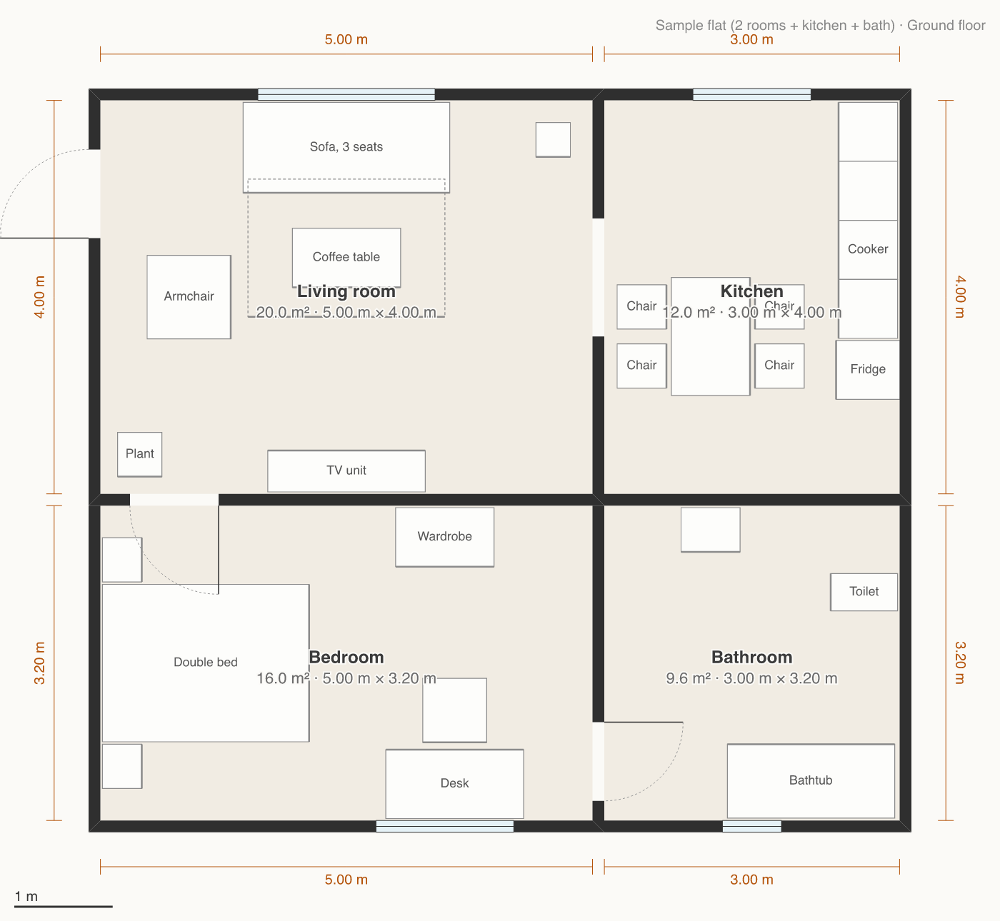

# Fullscale

Capture, design and edit spaces in 3D at **real size**, together with an AI agent.

Scan a room with your phone, or start from a floor plan or a blank page, then redesign it: move walls, add doors and windows, place furniture, change colours. Every dimension says where it came from and how accurate it is ("3.42 m ±1 cm, scanned"), and stays honest as you edit. An AI agent can do the same edits through MCP, safely, next to you.

> **Status: early.** The engine works and is tested; there is no app to open yet. See [what works](#what-works) and the [plan](docs/PLAN.md).



## What works
- **The space model** (`packages/core`): levels, walls, doors, windows, rooms, furniture and materials, in metres. Each dimension can carry its source and ± uncertainty, and edits update them automatically, so a guess never passes as a measurement.
- **Safe editing:** every edit is a validated command. Bad edits are refused with a clear reason ("use an offset between 0 and 2 m"), misspelt fields are refused, ids are never reused, and a batch of edits is all-or-nothing.
- **Undo per person and per agent**, field by field: undoing your move keeps the colour the agent painted. If you both changed the same thing, the undo is refused and says what changed.
- **Measurements:** room areas, paintable wall area, "does this sofa fit through that door", clearances.
- **Walls that join cleanly** at any angle, including T-junctions, in both 2D and 3D.
- **A 2D floor plan** as SVG or PNG (above), for people and for agents to look at.
- **A Three.js scene builder** (`packages/three`): walls with real door and window openings, furniture at exact sizes, and your own 3D models (e.g. downloaded furniture) fitted to their true size.
- **Lengths typed the way people write them:** `3.5`, `350 cm`, `1m80`, `12' 6"`.
- **Files that keep opening:** older format versions are upgraded, and damaged parts are set aside and reported instead of lost.

## Coming next
The live server with agent tools (MCP), the editor app, phone capture apps (iPhone with and without LiDAR, Android), importing scans, and photo-real renders with Blender. See [docs/PLAN.md](docs/PLAN.md) and the stack choices in [docs/DECISIONS.md](docs/DECISIONS.md).

## Develop

Needs Node 22.12 or newer.

```sh
npm install
npm test            # vitest
npm run typecheck   # TypeScript
```

| Path | What |
|---|---|
| `packages/core` | The space model: schema, geometry, edits, undo, measurements, validation, 2D plan. Pure TypeScript; its only runtime dependency is Zod |
| `packages/three` | Builds a Three.js scene from a space |
| `apps/server` | Server for the editor and agents (in progress) |
| `data/models/` | Your own 3D models; git-ignored (see its README) |
| `docs/` | Plan and decisions |

Conventions: metres, +Y up, plan points `[x, z]`, rotations in degrees counter-clockwise seen from above.

## Privacy
Real scans and photos of homes are private. Keep them in the git-ignored folders; this repo only contains synthetic sample data.

## Licence
[MIT](LICENSE).
