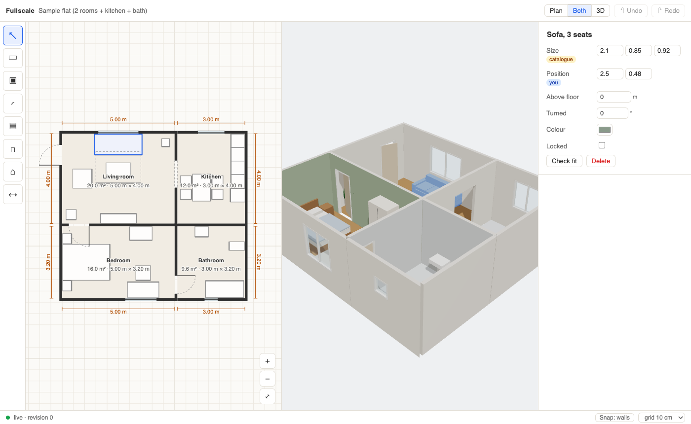

# Fullscale

Capture, design and edit spaces in 3D at **real size**, together with an AI agent.

Scan a room with your phone, or start from a floor plan or a blank page, then redesign it: draw walls, add doors and windows, place furniture, change colours. Every dimension says where it came from and how sure it is ("3.42 m ±1 cm, scanned"), and stays honest as you edit. An AI agent edits the same space through MCP, live, next to you, and Blender opens it for photo-real pictures.

> **Status: early.** The studio, the editor, the agent tools, the scan importer and the Blender link work and are tested. The iPhone app builds; it has not yet been tried on a phone. See [the plan](docs/PLAN.md).



## What works

- **The editor** (`apps/editor`): a 2D plan and a 3D view, live with the studio. Draw walls with snapping and typed lengths ("3.5", "350 cm", "11' 6\""); drag out rooms; put doors and windows on walls; place furniture that stands against walls; drag, nudge, turn and delete; click a dimension and type a length; paint walls, floors and furniture; undo and redo.
- **Rooms follow their walls.** Draw four walls and a room appears; move a wall and the room grows; add a wall across it and it splits. Walls drawn next to each other join and share.
- **Every number says where it came from**: scanned (with ±), typed by you, from a floor plan, the maker's size, a catalogue default, or a guess. Edits keep this honest, so a guess never passes as a measurement.
- **AI agents, through MCP** (`apps/server`): 40 tools to look (plan pictures with scale, 3D views, photo-real renders), measure (with ±), check "will it fit?" (saying what was and wasn't checked), build, furnish and paint. Every edit answers with what really changed; refusals say why and what would work. Agents undo only their own edits, and see what you changed and selected.
- **Phone scans** (`packages/capture`): the `fullscale-capture/1` format and an importer that turns a scan into walls, doors, windows, rooms and furniture, squared to the plan, and compares your tape checks with it.
- **Floor plan pictures**: lay one under a level and scale it from lengths you know; two lengths that disagree by over 2% are refused (the plan may not be to scale).
- **Blender** (`blender/`): an add-on that opens your home as real objects and keeps it in step both ways, and the script behind photo-real renders.
- **iPhone capture** (`apps/capture-ios`): scans rooms with LiDAR and Apple's room scanner, keeps sharp photos (and full-resolution ones) with one white balance per room, takes grey-card photos and tape checks, and writes a crash-safe capture folder. Its rules are tested on the Mac; the app builds in Xcode.
- **Your own furniture models**: put downloaded `.glb`/`.gltf` files in `data/models/`; items use them at their true size. They never leave your computer and are never exported.

## Try it

Needs Node 22.12 or newer.

```sh
npm install
npm run build                 # build the editor
npm run studio -- --sample    # start the studio with a sample flat
```

Open the link it prints. To let an AI agent work on the same home, add Fullscale as an MCP server in your agent app. It finds the running studio, or starts one. For example, in Claude Code:

```sh
claude mcp add fullscale -- npm run --silent --prefix /path/to/Fullscale mcp
```

Apps that connect over HTTP can use `http://127.0.0.1:4747/mcp` with the token from `npx tsx apps/server/src/cli.ts token` as a bearer token.

Your homes are saved in `data/homes/` (git-ignored). `npm run studio -- --home <folder>` opens another one.

## Develop

```sh
npm run studio:dev    # the studio, allowing the editor's development server
npm run dev           # the editor with live reload, at http://127.0.0.1:5173/#token=<token>
npm test              # TypeScript tests (the browser tests run when a Chromium is installed: npx playwright-core install chromium-headless-shell)
npm run test:blender  # the Blender add-on's tests (Python 3.9+)
npm run test:ios      # CaptureKit's tests (Swift 6)
npm run check         # lint, types and tests
```

| Path | What |
|---|---|
| `packages/core` | The space model: schema, geometry, walls and rooms, edits, undo, measurements, fit checks, validation, the 2D plan. Pure TypeScript; its only dependency is Zod |
| `packages/three` | Builds a Three.js scene from a space, and writes it as GLB |
| `packages/protocol` | Messages between the studio and its live clients |
| `packages/capture` | The capture format and the scan importer |
| `apps/server` | The studio: owns the home, serves the editor, Blender and agents (MCP) |
| `apps/editor` | The editor |
| `apps/capture-ios` | The iPhone capture app |
| `blender/` | The Blender add-on and render script (GPL) |
| `fixtures/` | Test cases shared by TypeScript, Swift and (later) Kotlin |
| `docs/` | The plan, decisions and the capture format |

Conventions: metres, +Y up, plan points `[x, z]`, rotations in degrees counter-clockwise seen from above. See [CONTRIBUTING.md](CONTRIBUTING.md).

## Privacy

Everything runs on your computer. Real scans and photos of homes are private: keep them in the git-ignored folders. The studio only listens on this computer and needs its token. This repository only contains synthetic sample data.

## Licence

[MIT](LICENSE), except the Blender add-on in `blender/`, which is GPL-3.0-or-later as Blender requires.
